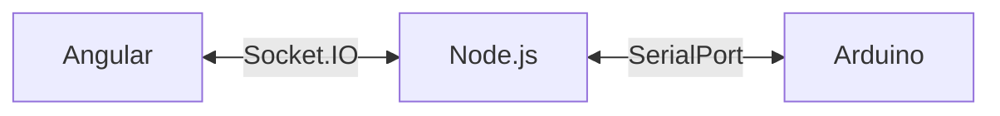

<div align="center">

# Controle de Lâmpadas | WebSocket & Arduino

### Demonstração de acionamento e comunicação entre interface web, Node.js e dispositivo serial, com atualizações via Socket.IO.

[](https://github.com/KalleoLeandro/controle-lampadas-websocket)


     

</div>

---

## ✨ Visão geral

Demonstração de acionamento e comunicação entre interface web, Node.js e dispositivo serial, com atualizações via Socket.IO.

## 🚀 O que você encontra aqui

- **Comunicação bidirecional com Socket.IO**
- **Ponte entre comunicação serial e aplicação web**
- **Front-end Angular**
- **Back-end Express e TypeScript**

## 🧰 Tecnologias

`Angular`, `Node.js`, `TypeScript`, `Socket.IO`, `SerialPort`, `Arduino`.

## 🖼️ Visão técnica / demonstração



## ▶️ Como explorar / executar

```bash
cd back-end
npm install
# Crie o .env contendo PORT=3000
npm run start-dev
```
Em outro terminal, acesse `front-end/socket-teste`, instale as dependências e execute `npm start` (confirme os scripts em `package.json`). Ajuste a porta serial usada no computador.

## 📁 Repositório

```bash
git clone https://github.com/KalleoLeandro/controle-lampadas-websocket.git
cd controle-lampadas-websocket
```

[Consultar os arquivos e o histórico do projeto](https://github.com/KalleoLeandro/controle-lampadas-websocket)

## 📝 Observações

> **Hardware:** a execução completa depende de dispositivo conectado e da porta serial correta.

---

<div align="center">

Desenvolvido e mantido por [Kalleo Leandro](https://github.com/KalleoLeandro).

⭐ Se este projeto for útil, considere deixar uma estrela.

</div>
